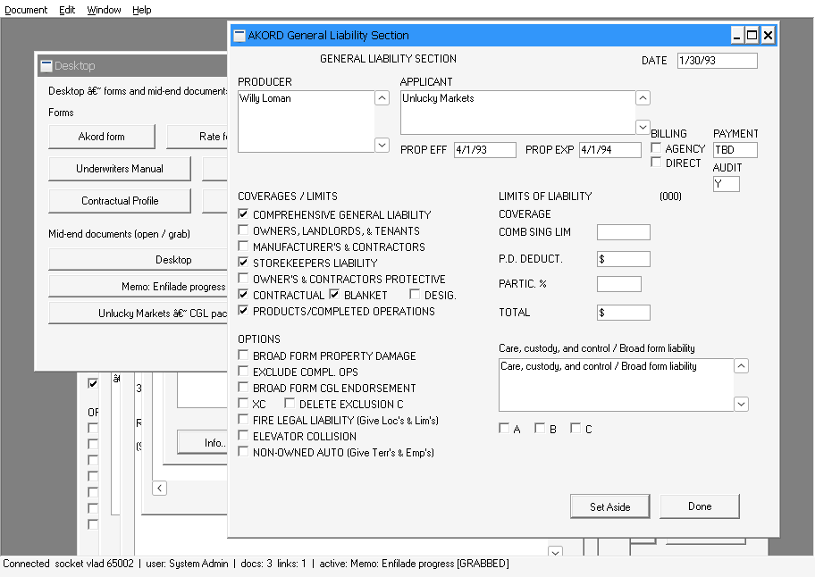

# winfe-resurrect

Visual resurrection of the **1993 Udanax Gold Windows frontend** (`winfe` / `pcaide`), with an in-memory stub mid-end for pseudo document and link operations.

Historical UI effort — not a live FeBe / Xanadu protocol client.



## Features

### UI (from original sources)
- MDI frame with Document / Edit / Window / Help menus
- Historical forms from `fe.rc` and `pcaide/*.pvt`:
  - Desktop launcher, Memorandum, Rating Instructions, Akord GL,
    Underwriters Manual, Attention, Reference Area, Contractual Profile
- Modal Login, Document Info, Link Info
- Keyboard accelerators (Ctrl+X/C/V/Z/F/G/R, Del)

### Stub mid-end
- Seed documents (Desktop, Memo, CGL package) and a sample link
- **Grab / Release / New variant / Variants… / New document / Delete**
- **Start Link / End Link** on text selections (span + descriptor)
- **Attachment** of the current selection
- Per-document **Links** pane (list + Follow to other end/span)
- Document Browser and Link Browser
- Multi-window document editors (each bound to a doc id)
- **Save All** syncs all open editors into memory
- **Export / Import** `winfe-midend.stub` snapshot files
- Find / Find Next / **Replace All**
- Clubs list dialog; Document Info edits title and permissions

## Build

### Nix
```bash
nix build          # result/bin/winfe_resurrect.exe
nix run            # build + run under Wine (temp WINEPREFIX)
nix develop        # MinGW + Wine shell
```

### MinGW
```bash
make
wine64 winfe_resurrect.exe
```

## Layout

| File | Role |
|------|------|
| `winfe_resurrect.cpp` | All UI + stub backend |
| `fe.rc` / `fe.h` | Historical reference (not compiled in) |
| `flake.nix` | Cross-compile + Wine runner |

## Sources

- https://github.com/xanatoo/udanax-gold (`winfe/`, `winfe/pcaide/`)

Original stack: Borland OWL + PVDialog, tightly bound to the Udanax object model. This recreation is standalone Win32 for historical study.
